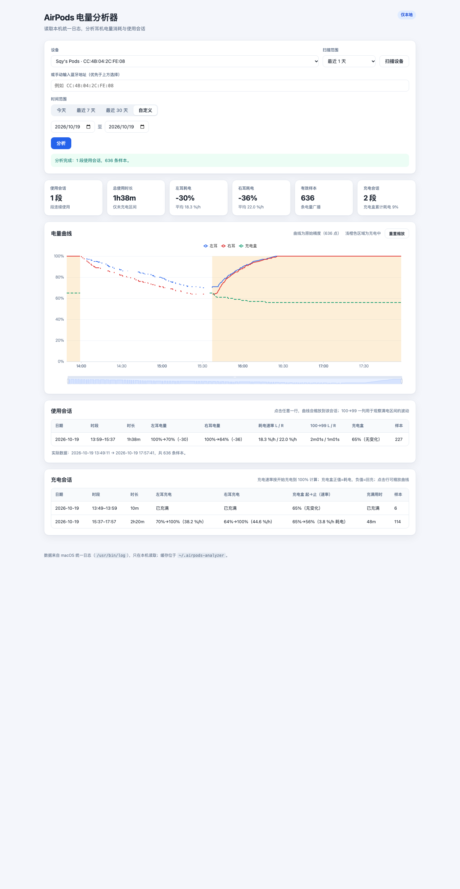

# AirPods 电量分析器

读取 macOS 统一日志，在本地浏览器里分析 AirPods / AirPods Pro 的电量消耗与使用会话。



## 功能

- **自动发现设备**：从日志中识别真实 AirPods 设备（按稳定主地址归并系统随机化的 BLE 地址），也可手动输入蓝牙地址
- **时间范围**：今天 / 最近 7 天 / 最近 30 天 / 自定义起止日期
- **电量曲线**：左耳、右耳、充电盒三条曲线，支持缩放、平移、悬停查看数值；浅橙色区域为充电中
- **使用会话表**：自动切分"取出使用 → 回盒/充电"的连续区间，给出起止电量、消耗、平均 `%/h`、`100%→99%` 耗时、充电盒读数、样本数
- **充电会话表**：自动切分充电区间，给出左右耳充电起始电量、充电速率、充满用时，以及同时间充电盒的耗电/回充速率
- **会话联动**：点击任意会话行，曲线自动缩放到该会话
- **进度与取消**：日志查询在后台执行，界面实时显示读取行数/样本数/耗时，可随时取消
- **本地缓存**：已抓取的时间段不会重复查询，后续分析秒开
- **采样压缩**：入库时合并连续重复读数，长时间范围下曲线自动降采样，避免数据过密
- **仅本地**：服务只绑定 `127.0.0.1`，数据不出本机

## 环境要求

- macOS（使用 `/usr/bin/log` 读取统一日志）
- Python 3.9+（已在 Python 3.13 上验证）
- **不需要安装任何 Python 包或 npm 包**；ECharts 已放在 `web/vendor/` 中

## 快速开始

```bash
cd ~/Downloads/airpods-battery-analyzer
python3 app.py
```

启动后会自动打开浏览器，默认地址：

```text
http://127.0.0.1:8765/
```

常用参数：

```bash
python3 app.py --port 8766        # 换端口
python3 app.py --no-open          # 不自动打开浏览器
python3 app.py --db /path/to.db   # 指定缓存数据库
```

## 使用流程

1. 首次打开会扫描最近 1 天的设备；找不到时把"扫描范围"改为 7/30 天后点"扫描设备"
2. 在"设备"下拉框选择 AirPods，或在下方手动输入蓝牙地址
3. 选择时间范围，点击"分析"
4. 首次抓取某个时间段需要等待：
   - 1 天通常十几秒到几十秒
   - 30 天通常 1~2 分钟（统一日志本身的查询开销）
   - 界面会显示进度，可点击"取消抓取"
5. 分析完成后查看曲线和会话表；点击会话行可放大对应时间段

### 深链接

可以把分析视图直接写进 URL，方便收藏或复用：

```text
http://127.0.0.1:8765/?address=CC:4B:04:2C:FE:08&preset=custom&start=2026-10-19&end=2026-10-19&autostart=1
```

- `address`：蓝牙地址
- `preset`：`today` / `7d` / `30d` / `custom`
- `start`、`end`：仅 `custom` 时使用，格式 `YYYY-MM-DD`
- `autostart=1`：打开页面后自动开始分析

## 数据来源

工具会解析以下几类日志（都带 AirPods 的蓝牙地址和 `Batt`/`Battery` 字段）：

| 来源 | 用途 |
|---|---|
| `sharingd` · `BLEAdv` · `BLE Prox` | 主要的电量广播，包含 L/R/C、连接状态（`Cnx yes/no`）、充电符号 `+/-` |
| `audioaccessoryd` · `AADeviceBatteryInfo` / `AANearbyDevice` | 稳定设备身份、设备名、L/R/C 电量（部分机型只有这里有数据） |
| `bluetoothd` · `Component battery changed` | 已连接状态下的 L/R/C 电量 |

### 设备身份

AirPods（尤其是盒盖关闭的充电盒）会使用不断变化的随机 BLE 地址广播。工具通过日志中的 `Prim Bt addr`、`AADeviceBatteryInfo` 的稳定 `Bt Addr` 把这些临时地址归并到同一台物理设备，因此设备下拉框里看到的是：

```text
Sqy's Pods · CC:4B:04:2C:FE:08
Sqy's Pods Pro · A4:C6:F0:CD:1D:2F
```

而不是几十个随机地址。

## 分析口径

### 使用会话

- 只把 `Cnx yes`（已连接）的样本用于切分使用会话
- 任一只耳机开始充电、或相邻样本间隔超过 60 分钟，即结束当前会话
- 缺失的电量不做插值，曲线上显示为断点
- `0%` 视为"未知/无效读数"，不参与曲线和统计（`bluetoothd` 在电量未知时会报 `Cs 0%`）
- `100%→99%` 一列记录满电后第一次掉到 99% 的耗时；如果中间广播缺失，会显示"跳→96%"之类的提示
- 左右耳分别统计；长时间使用时通常右耳略快

### 充电会话

- 至少一只耳机在充电即视为一段充电会话；两只都明确不在充电时结束，未知状态不会打断会话
- **耳机充电速率** = `(100% - 起始电量) / 从该耳开始充电到首次达到 100% 的时长`；如果一开始就是 100%，速率记为 0 并显示"已充满"
- **充电盒耗电速率** = `(起始盒子电量 - 结束盒子电量) / 整段充电会话时长`；正值表示盒子在耗电，负值表示盒子在回充
- 盒子电量读数稀疏，只有至少两个读数时才计算速率；不足时显示单次读数
- 曲线上的浅橙色区域直接对应充电会话的起止时间

## 采样压缩与降采样

- **入库压缩**：只保留电量或充电/连接状态发生变化的样本；状态长时间不变时，每 5 分钟保留一个心跳点
- **曲线降采样**：返回给前端的曲线按时间桶聚合，最多 2000 个点；使用会话和充电会话统计始终基于完整（压缩后）的样本
- **抓取提速**：`log show` 谓词只扫描 `sharingd` / `audioaccessoryd` / `bluetoothd` 三个相关进程；实测 4 小时窗口比不限制进程快约 27%
- 图表右上角会显示当前精度：
  - `曲线为原始精度（N 点）`
  - `曲线已降采样：N → M 点`
- 实测 2026-10-19 一天：解析 1,264 条电量记录，入库压缩后 636 条，分析接口约 20ms；首次抓取耗时主要来自 `log show` 本身

## 缓存与性能

- 缓存位置：`~/.airpods-analyzer/cache.sqlite3`
- 缓存按"设备 + 时间区间"记录已抓取范围；请求新范围时只补抓缺口
- 想彻底重抓：停止服务后删除该文件即可
- 30 天首次查询仍然较慢，这是 `log show` 扫描统一日志的成本；缓存后为毫秒级

## 已知限制

- **只能分析这台 Mac 看到的日志**：如果耳机只连接了 iPhone，Mac 上没有连接使用记录，只能看到附近广播到的电量
- **日志保留期有限**：统一日志可能只保留最近十几天，更早的数据会被系统轮转清理；界面底部会显示实际有数据的范围
- 充电盒电量是稀疏广播，读数次数可能远少于耳机；不足两个读数时不计算盒子速率
- 充电会话依赖电量广播中的充电符号 `+/-`；如果某段日志没有明确充电状态，该段不会计入充电会话
- 首次扫描 7/30 天设备时较慢；之后会使用缓存

## 开发与测试

```bash
# Python 单元测试（98 个）
python3 -m unittest discover -s tests

# 前端纯逻辑测试（15 个，使用 Node 内置 test runner）
node --test tests/frontend.test.js
```

## 目录结构

```text
airpods-battery-analyzer/
├── app.py                 # 启动入口
├── airpods/
│   ├── logfetch.py        # 调用 /usr/bin/log show
│   ├── parser.py          # 解析 BLE / audioaccessoryd / bluetoothd 日志
│   ├── sessions.py        # 使用会话切分与耗电速率
│   ├── charging.py        # 充电会话、耳机充电速率与盒子耗电速率
│   ├── compress.py        # 入库时合并重复读数
│   ├── downsample.py      # 曲线按时间桶降采样
│   ├── analysis.py        # 汇总统计与充电区间
│   ├── cache.py           # SQLite 缓存（设备/样本/已抓取范围）
│   ├── jobs.py            # 后台抓取任务、进度与取消
│   └── server.py          # HTTP API 与静态文件
├── web/
│   ├── index.html
│   ├── app.js
│   ├── logic.js           # 可单测的纯函数
│   ├── style.css
│   └── vendor/echarts.min.js
└── tests/
```

## 故障排查

- **没有发现设备**：把扫描范围扩大到 7 天；仍没有就手动输入蓝牙地址（形如 `CC:4B:04:2C:FE:08`）
- **端口被占用**：`python3 app.py --port 8766`
- **查询很慢**：30 天范围本身较慢，等待或取消后改用 7 天；已抓取过的区间会命中缓存
- **界面没有数据**：检查底部"实际数据"范围；如果请求的开始日期早于该范围，说明更早的日志已被系统清理
- **终端里 `log` 被 zsh 内建占用**：本工具在子进程中直接调用 `/usr/bin/log`，不受影响
